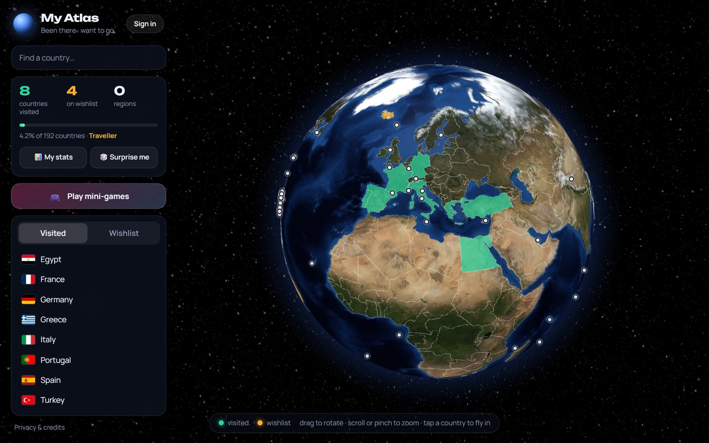
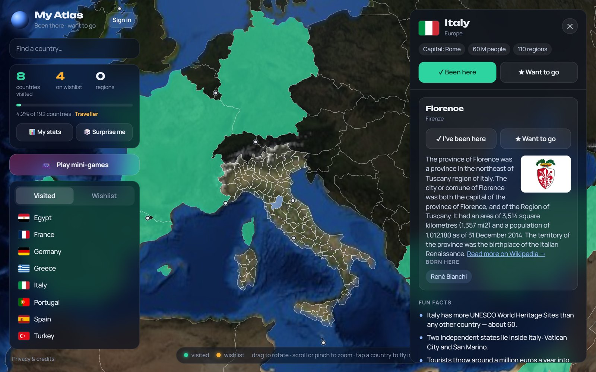
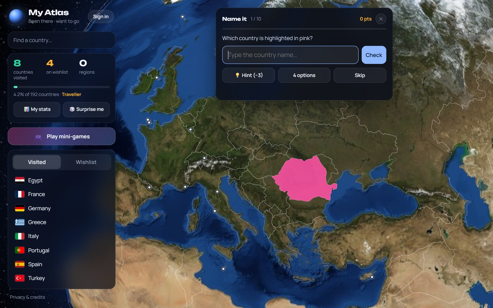
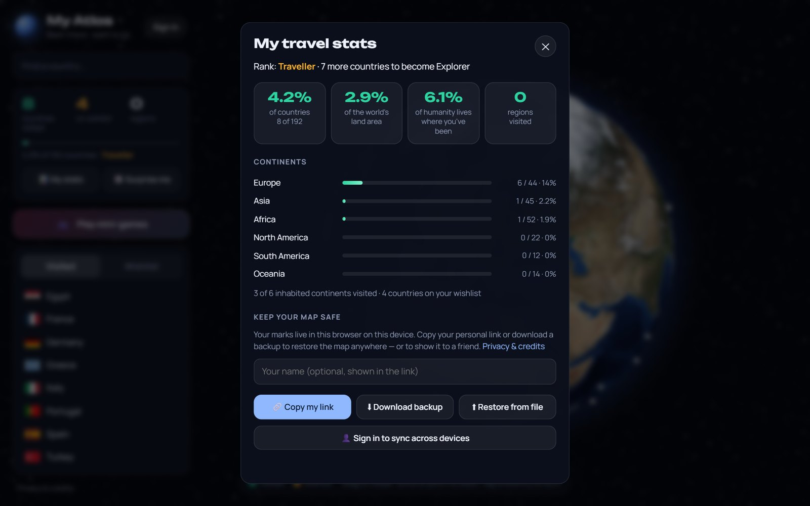
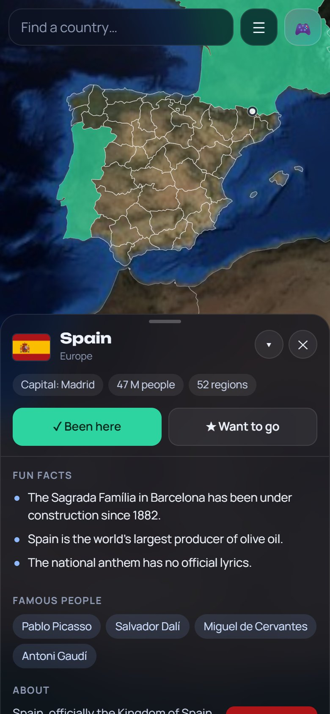

# My Atlas — an interactive travel globe

Spin a 3D globe, mark the countries and regions you have visited or want to see, and track how much of the world you have explored.

**[Open the live site → myatlas-map.vercel.app](https://myatlas-map.vercel.app)**

## Features

- **3D globe** — rotate, zoom and click a country to fly in; it splits into its regions. Tiny states such as Vatican City get tappable pins.
- **Been here / want to go** — marks for 242 countries and territories and 4,559 regions.
- **Facts on hover** — hand-written facts and famous people for 136 countries; summaries and people born in each region come live from Wikipedia and Wikidata.
- **Travel stats** — share of countries, land area and world population visited, progress by continent and a traveller rank.
- **Mini-games** — name the highlighted country, find a country on the globe, guess the flag.
- **Accounts** — sign in with Google or email and the map syncs across devices. Share links and backup files work without an account.
- **Phone-friendly** — bottom sheet for country details, menu drawer and touch controls.

## Screenshots

| Country and regions | Name it game |
| --- | --- |
|  |  |

| Travel stats | Phone |
| --- | --- |
|  |  |

## Tech stack

| Area | Technology |
| --- | --- |
| Frontend | Vanilla JavaScript, HTML, CSS — no framework |
| 3D globe | [globe.gl](https://github.com/vasturiano/globe.gl) on [three.js](https://threejs.org/) (WebGL) |
| Map data | [Natural Earth](https://www.naturalearthdata.com/) borders, simplified with mapshaper |
| Facts | Wikipedia REST API, Wikidata SPARQL |
| Accounts and storage | [Supabase](https://supabase.com/) — Auth (Google, email) and Postgres with Row Level Security |
| Hosting | [Vercel](https://vercel.com/) |

## How it works

- The site is static: the browser renders the globe and the interface, and Vercel only serves files.
- Regions load only for the country you open, so the first load stays small.
- Each user's map is one JSON row in Postgres. Row Level Security lets a user read and write only their own row, so the public key in the page is safe.
- Changes are saved a moment after the last edit; on first sign-in the local and cloud maps are merged.

## Highlights

- **Performance:** cut rendering from about 5,500 draw calls and 90 ms per frame to about 870 draw calls and 5 ms by fixing polygon winding, dropping micro-islands and skipping hidden faces.
- **Touch:** a custom tap hit test (screen point → latitude/longitude → point in polygon) makes selection reliable on phones.
- **Forgiving game:** answers tolerate typos (Levenshtein distance), with four same-continent choices on the last try.

## Source code

The source code is private. I'm happy to walk through it — get in touch through my GitHub profile.

## Credits

Borders: Natural Earth (public domain). Earth imagery: NASA Blue Marble. Descriptions: Wikipedia (CC BY-SA 4.0) and Wikidata (CC0). Flags: Flagpedia. Full credits and third-party licenses are on the site's [Privacy & credits](https://myatlas-map.vercel.app/privacy#credits) page.
